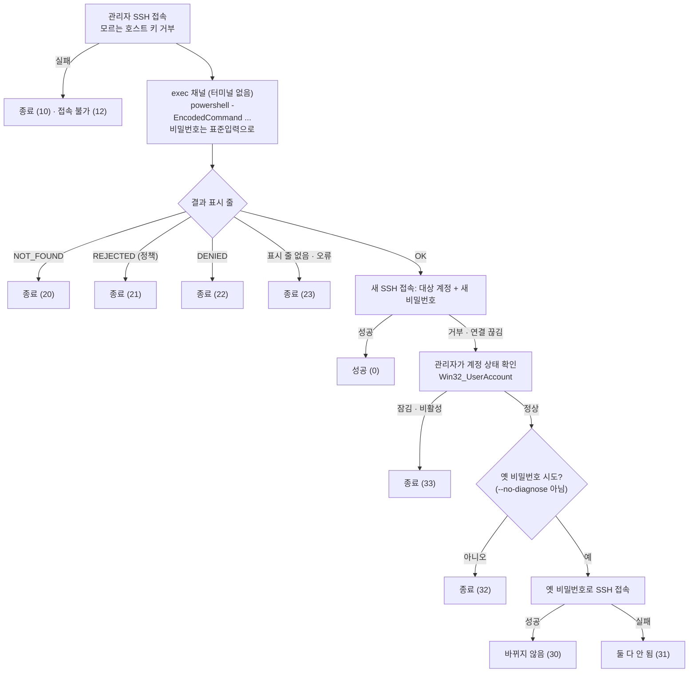

# windows-ssh-password-rotate

SSH로 Windows 로컬 계정의 비밀번호를 바꾸고, **새 비밀번호로 SSH 로그인이 되는지까지 확인**하는 도구입니다. 대상 서버의 셸이 엔터와 제어 코드를 어떻게 다루는지 원본 바이트로 보여주는 진단 명령(`probe`)도 들어 있습니다.

테스트 VM에서 최신 Windows OpenSSH에 SSH로 접속해 셸 화면에 명령을 보내는 방식의 비밀번호 변경을 실습했습니다. 그때 명령이 실행되지 않는 문제를 겪었고, 원본 출력을 그대로 보는 진단 스크립트로 원인을 가렸습니다. 이 레포는 그때 알게 된 것을 바탕으로 **처음부터 새로 쓴 도구**입니다.

```text
07:39:21 start: rot_app on localhost:22
07:39:22 admin sign-in: ok (rot_admin)
07:39:22 change: OK (exit 0)
07:39:22 verify: new password did not sign in: connection dropped (localhost:22: ConnectionResetError: [WinError 10054] An existing connection was forcibly closed by the remote host)
FAIL 33: password changed, but rot_app is disabled; new password not verified
```

GitHub Actions의 Windows 서버(OpenSSH_for_Windows 9.5p2)에서 실제로 나온 출력입니다. 비활성화된 계정은 비밀번호를 바꿀 수 있습니다. 하지만 로그인하려 하면 sshd가 거부 응답 대신 **연결을 끊어 버립니다**. 이걸 "서버에 접속할 수 없음"으로 판정하면 원인을 잘못 짚게 됩니다. 그래서 관리자 세션으로 계정 상태를 물어 "비활성화됨"이라고 알립니다.

## 진단: `probe`

실습에서 겪은 문제를 같은 방식으로 다시 확인한 결과입니다. 둘 다 CI에서 실제 SSH 서버에 대화형 셸(PTY)로 접속해 얻었습니다.

| | Windows OpenSSH 9.5p2 (cmd.exe) | Ubuntu OpenSSH (bash) |
|---|---|---|
| LF(`\n`)만 보내면 명령 실행 | **안 됨**: 두 명령이 `echo WSPR_LF_1echo WSPR_LF_2` 한 줄로 붙음 | 됨 |
| CR LF(`\r\n`)로 보내면 실행 | 됨 | 됨 |
| 제어 코드 | CSI 6개. 줄바꿈 대신 커서 이동(`ESC[10;1H`)으로 다음 줄을 시작 | CSI 10개, OSC 13개 (셸 통합 신호) |

```text
--- raw crlf (Windows):
b'echo WSPR_CRLF\r\n\x1b[?25lWSPR_CRLF\x1b[10;1Hrot_admin@... C:\\Users\\rot_admin>\x1b[?25h'
```

여기서 두 가지를 알 수 있습니다.

1. **LF를 엔터로 보내는 스크립트는 최신 Windows OpenSSH에서 깨집니다.** 실습에서 확인했던 증상이 지금 버전에서도 그대로 재현됩니다.
2. **제어 코드를 지우기만 하면 줄이 붙습니다.** 위 출력에서 제어 코드를 그냥 지우면 `WSPR_CRLFrot_admin@...`이 한 줄이 됩니다. 커서 이동 코드를 줄바꿈으로 바꿔야 "출력이 한 줄로 따로 나왔는가"를 판단할 수 있습니다. 처음 만든 probe도 이 실수를 했고, CI의 실제 출력으로 찾아 고쳤습니다.

제어 코드 자체는 Windows만의 문제가 아닙니다. Linux 쪽이 오히려 더 많았습니다. 실습에서는 창 제목 신호 안에 명령 글자가 들어 있어 잘못 일치할 위험도 봤습니다. 그런데 CI의 Windows 서버에서는 창 제목 신호(OSC)가 나오지 않았습니다.

```bash
winssh-rotate probe --host win.example.test --user someone --password-env PW
```

probe 출력에는 호스트 이름, 사용자, 경로가 그대로 나옵니다. 내부 자료로 다루세요. `--raw 0`이면 원본 바이트는 빼고 요약만 보여줍니다.

## 변경: `rotate`



| 파일 | 하는 일 |
|---|---|
| `remote.py` | 원격에서 실행할 PowerShell 스크립트 만들기, 계정 이름 검사와 따옴표 처리, 결과 표시 줄 읽기 |
| `ssh.py` | paramiko를 쓰는 유일한 파일. exec 채널 실행과 대화형 셸(probe용) |
| `flow.py` | 변경 → 새 접속으로 확인 → 실패 원인 구분 |
| `probe.py` | 대화형 셸에 LF / CR / CR LF를 보내 원본 바이트를 분석 |
| `cli.py` | `rotate`, `probe` 두 명령. 결과 한 줄은 stdout, 원인은 종료코드 |

| 코드 | 뜻 |
|---|---|
| `0` | 바꿨고, 새 비밀번호로 SSH 로그인까지 됨 |
| `2` | 인자 오류, Windows가 허용하지 않는 계정 이름 |
| `10` | 관리자 로그인 실패 |
| `12` | 서버에 닿지 못함, 모르는 호스트 키, 키 교환 방식 불일치 |
| `20` | 계정 없음 |
| `21` | Windows 비밀번호 정책이 거부함 |
| `22` | 권한 없음 (관리자가 아님) |
| `23` | 그 밖의 실패. 결과 표시 줄이 없으면 성공으로 보지 않음 |
| `30` | 바뀌지 않음: 옛 비밀번호로 아직 로그인됨 |
| `31` | 새 비밀번호도 옛 비밀번호도 안 됨 (SSH 로그인 자체가 허용되는지 확인 필요) |
| `32` | 새 비밀번호로 안 됨. 옛 비밀번호는 일부러 시도하지 않음 |
| `33` | 비밀번호는 바뀌었지만 계정이 잠겨 있거나 비활성이라 새 비밀번호를 확인하지 못함 |

## 설계 판단

**화면을 읽지 않습니다.** 셸 화면에 `net user 계정 비밀번호`를 입력하고 출력 글자를 읽는 방식에는 문제가 네 가지 있습니다.
- 위 probe 결과처럼 엔터 처리와 제어 코드에 따라 깨집니다
- 비밀번호가 명령줄에 실려 대상 Windows의 프로세스 목록과 감사 로그에 남을 수 있습니다
- cmd가 `& | ^ %`를 특수문자로 해석합니다
- 성공 문구가 Windows 표시 언어에 따라 달라집니다

이 도구는 터미널 없는 exec 채널로 명령 하나만 실행합니다. 스크립트는 base64(`-EncodedCommand`)로 보내서 cmd나 PowerShell이 그 안을 해석할 틈이 없습니다. 비밀번호는 표준입력으로 보내고 PowerShell이 `[Console]::In.ReadLine()`으로 읽습니다. CI 테스트는 `N3w&pass|with^cmd%chars"!` 같은 비밀번호로 실제 변경과 로그인까지 확인합니다.

**결과는 정해 둔 표시 줄로만 판단합니다.** 스크립트는 `WSPR-RESULT:상태:내용` 한 줄을 출력합니다. 도구는 다른 출력(배너, 제어 코드)을 무시하고 이 줄만 봅니다. 그래서 한글판 Windows에서도 결과를 똑같이 읽습니다. 이 줄이 없으면 실패입니다. "The operation completed successfully." 같은 문구가 보여도 성공으로 보지 않습니다.

**계정 이름은 문자열로만 쓰입니다.** Windows가 계정 이름에 허용하지 않는 문자(`" / \ [ ] : ; | = , + * ? < > @`)가 있으면 접속하기 전에 거부합니다. 통과한 이름은 PowerShell 작은따옴표 문자열(`'O''Brien'`)로 넣습니다. 그래서 `$(...)` 같은 것이 들어 있어도 실행되지 않습니다.

**로그인 실패의 이유는 따로 물어봅니다.** Windows는 잠긴 계정, 비활성 계정, 틀린 비밀번호를 SSH 쪽에 구분해서 알려주지 않습니다. 비활성 계정은 아예 연결을 끊었습니다. 그래서 확인 로그인이 실패하면 관리자 세션으로 `Win32_UserAccount`의 `Lockout`, `Disabled`를 조회합니다. 잠겼거나 비활성이면 33입니다. CI에서 확인한 사실: **비밀번호를 바꿔도 잠금은 풀리지 않습니다.** 도구도 잠금을 풀지 않습니다.

**옛 비밀번호 시도는 끌 수 있습니다.** 틀린 시도는 잠금 임계값에 쌓입니다. `--no-diagnose`로 끌 수 있고, 테스트는 이때 실패가 한 번만 쌓이는지 확인합니다.

**모르는 호스트 키는 받지 않습니다.** 처음 보는 서버에 비밀번호를 보내지 않도록, known_hosts에 없는 키는 거부합니다. 키 교환 방식이 맞지 않으면 그렇다고 알려줍니다. 실습에서는 오래된 SSH 클라이언트와 최신 서버 사이에 이 문제가 있었습니다.

**SSH 로그인이 허용된 계정이어야 확인할 수 있습니다.** CI의 Windows 이미지는 sshd 설정에 `AllowGroups administrators "openssh users"`가 있었습니다. 그래서 일반 계정은 비밀번호를 확인하기도 전에 거부됐고, 틀린 비밀번호로 잠기지도 않았습니다. sshd 이벤트 로그를 출력하게 해서 원인을 찾았습니다. 둘 다 안 될 때(31) 나오는 안내 문구에 이 설정을 적어 두었습니다.

## 쓰는 법

```bash
pip install .
```

```bash
winssh-rotate rotate --host win.example.test --account svc_app --admin-user ops --admin-password-env ADMIN_PW --new-password-env NEW_PW --old-password-env OLD_PW
```

- 대상 서버의 호스트 키를 먼저 known_hosts에 넣어야 합니다(`--known-hosts`로 파일 지정 가능)
- 관리자 계정은 대상 서버의 Administrators 그룹이어야 합니다
- 확인 로그인을 하려면 대상 계정도 SSH 로그인이 허용돼 있어야 합니다
- 비밀번호는 환경변수로만 받습니다. 줄바꿈이 든 비밀번호는 거부합니다

## 테스트

```bash
pip install -e ".[test]"
pytest -v tests/test_offline.py   # 가짜 호스트(tests/fake_host.py)와 기록된 바이트로
```

CI(GitHub Actions)는 세 작업을 돌립니다.

| 작업 | 내용 |
|---|---|
| offline (Windows, Ubuntu) | 스크립트 만들기, 결과 읽기, 판정 흐름, probe 분석 (29개) |
| windows-openssh | Windows Server에 OpenSSH 서버를 켜고 계정을 만든 뒤 실제로 확인 (7개) |
| linux-probe | Ubuntu sshd에 probe를 돌려 비교용 기록을 남김 |

windows-openssh에서 확인하는 것:

| 경우 | 기대 |
|---|---|
| `& \| ^ % " !`이 든 비밀번호로 변경 | `0`, 새 비밀번호로만 로그인됨 |
| 정책 위반 (12자 미만) | `21`, 옛 비밀번호 그대로 |
| 없는 계정 | `20` |
| 관리자가 아닌 계정으로 다른 계정 변경 | `22` (Access denied) |
| 비활성 계정 | `33` (sshd가 연결을 끊음) |
| 세 번 틀려 잠긴 계정 | `33` (변경해도 잠금 유지) |
| probe | LF는 실행 안 됨, 두 명령이 붙음, CR LF는 실행됨 |
| 모든 경우 | 출력에 비밀번호 없음 |

## 만든 방식

실습에서 직접 겪은 문제(엔터 처리, 제어 코드, 키 교환 불일치)와 그때 쓴 방법(원본 출력을 보는 진단 도구를 먼저 만들기, 새 비밀번호로 로그인해 확인하기)을 바탕으로 구조를 잡았고, 코드는 Claude Code로 작성했습니다. 실습 환경의 코드, 주소, 계정은 들어 있지 않습니다.
